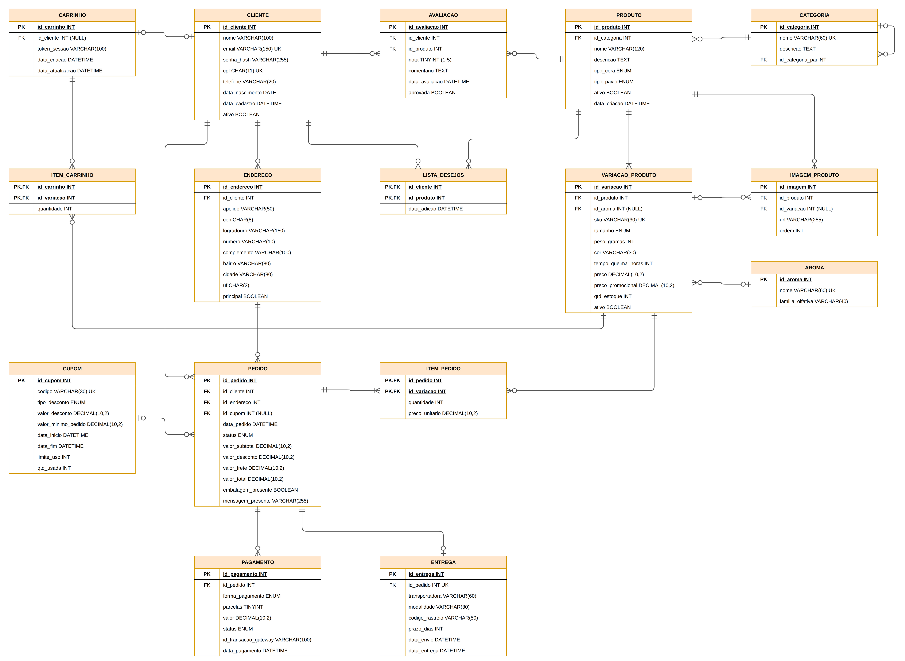

# API Loja de Velas

API REST em **Java 17 + Spring Boot 3** para a loja virtual de velas. Cobre catálogo (categorias, aromas, produtos, variações e imagens), clientes e endereços, carrinho, lista de desejos, cupons, pedidos, pagamentos, entregas e avaliações.



## Tecnologias

Spring Web, Spring Data JPA (Hibernate), Bean Validation, MySQL 8, Lombok, BCrypt (hash de senha) e springdoc-openapi (Swagger).

## Como rodar

**Requisitos:** JDK 17 ou superior, MySQL 8.0.16 ou superior e Maven (ou uma IDE como IntelliJ, que já traz o Maven).

1. Crie o banco rodando o script `database/loja_velas.sql` no MySQL (pelo Workbench ou pelo terminal: `mysql -u root -p < database/loja_velas.sql`).
2. (Opcional) Carregue os dados de exemplo: `mysql -u root -p < database/dados_exemplo.sql`.
3. Ajuste usuário e senha do MySQL em `src/main/resources/application.properties`, ou defina as variáveis de ambiente `DB_USER` e `DB_PASSWORD`.
4. Rode a aplicação:
   - pelo terminal: `mvn spring-boot:run`
   - pelo IntelliJ: abra a pasta do projeto e execute a classe `LojaVelasApplication`.
5. Acesse a documentação interativa em **http://localhost:8080/swagger-ui.html**. Lá dá para testar todos os endpoints.

## Endpoints

| Recurso | Método e rota | O que faz |
|---|---|---|
| Clientes | `GET /api/clientes` · `GET /api/clientes/{id}` | Lista / busca |
| | `POST /api/clientes` | Cadastra (senha salva com BCrypt) |
| | `PUT /api/clientes/{id}` · `DELETE /api/clientes/{id}` | Atualiza / desativa |
| Endereços | `GET`, `POST /api/clientes/{id}/enderecos` | Lista / adiciona |
| | `PUT`, `DELETE /api/clientes/{id}/enderecos/{idEndereco}` | Atualiza / remove |
| Categorias | `GET`, `POST /api/categorias` · `GET`, `PUT`, `DELETE /api/categorias/{id}` | CRUD |
| Aromas | `GET`, `POST /api/aromas` · `GET`, `PUT`, `DELETE /api/aromas/{id}` | CRUD |
| Produtos | `GET /api/produtos?categoria=&aroma=&busca=&page=&size=&sort=` | Catálogo paginado com filtros |
| | `GET`, `PUT`, `DELETE /api/produtos/{id}` · `POST /api/produtos` | Detalhe / CRUD (DELETE desativa) |
| Variações | `POST /api/produtos/{id}/variacoes` | Nova variação (aroma, tamanho, preço, estoque) |
| | `GET`, `PUT`, `DELETE /api/variacoes/{id}` · `PATCH /api/variacoes/{id}/estoque` | Detalhe / edita / desativa / ajusta estoque |
| Imagens | `POST /api/produtos/{id}/imagens` · `DELETE /api/imagens/{id}` | Adiciona / remove |
| Avaliações | `GET`, `POST /api/produtos/{id}/avaliacoes` | Lista aprovadas / avalia |
| | `GET /api/avaliacoes/pendentes` · `PATCH /api/avaliacoes/{id}/aprovar` · `DELETE /api/avaliacoes/{id}` | Moderação |
| Carrinho | `GET`, `DELETE /api/clientes/{id}/carrinho` | Ver / esvaziar |
| | `POST /api/clientes/{id}/carrinho/itens` | Adiciona item |
| | `PUT`, `DELETE /api/clientes/{id}/carrinho/itens/{idVariacao}` | Altera quantidade / remove |
| Lista de desejos | `GET /api/clientes/{id}/lista-desejos` · `POST`, `DELETE .../lista-desejos/{idProduto}` | Ver / adicionar / remover |
| Cupons | `GET`, `POST /api/cupons` · `GET`, `PUT`, `DELETE /api/cupons/{id}` | CRUD |
| | `GET /api/cupons/validar/{codigo}?subtotal=150` | Simula o desconto |
| Pedidos | `POST /api/clientes/{id}/pedidos` | Checkout: fecha o pedido com o carrinho |
| | `GET /api/clientes/{id}/pedidos` · `GET /api/pedidos/{id}` | Histórico / detalhe |
| | `PATCH /api/pedidos/{id}/status` · `POST /api/pedidos/{id}/cancelar` | Muda status / cancela |
| Pagamentos | `POST /api/pedidos/{id}/pagamentos` | Registra pagamento (PENDENTE) |
| | `PATCH /api/pagamentos/{id}/status` | Aprova, recusa ou estorna |
| Entrega | `PUT /api/pedidos/{id}/entrega` · `PATCH /api/pedidos/{id}/entrega/confirmar` | Registra envio / confirma entrega |

## Regras de negócio implementadas

- **Checkout em uma transação só:** confere o estoque de cada item, dá baixa, congela o preço (o promocional, se houver), aplica o cupom, calcula os totais e esvazia o carrinho. Se qualquer passo falhar, nada é gravado.
- **Cupom:** precisa estar no período de validade, ter usos disponíveis e o pedido precisa atingir o valor mínimo. O desconto nunca passa do subtotal.
- **Fluxo do pedido:** `AGUARDANDO_PAGAMENTO → PAGO → EM_SEPARACAO → ENVIADO → ENTREGUE`. Pode ser cancelado até antes do envio. Transições inválidas são recusadas.
- **Cancelamento ou estorno** devolve os itens ao estoque e libera o uso do cupom.
- **Pagamento aprovado** muda o pedido para PAGO automaticamente. Parcelamento só no cartão de crédito (até 12x).
- **Avaliações:** só quem recebeu o produto pode avaliar, uma vez por produto, e a avaliação só aparece depois de aprovada.
- **Exclusão lógica** de clientes, produtos e variações (`ativo = false`), para não quebrar o histórico de pedidos.

## Exemplo de fluxo de compra

```http
POST /api/clientes
{ "nome": "Ana Souza", "email": "ana@email.com", "senha": "segredo123", "cpf": "12345678901" }

POST /api/clientes/1/enderecos
{ "cep": "22041001", "logradouro": "Av. Atlântica", "numero": "1702", "bairro": "Copacabana", "cidade": "Rio de Janeiro", "uf": "RJ" }

POST /api/clientes/1/carrinho/itens
{ "idVariacao": 2, "quantidade": 2 }

POST /api/clientes/1/pedidos
{ "idEndereco": 1, "codigoCupom": "BEMVINDO10", "valorFrete": 18.50, "embalagemPresente": true, "mensagemPresente": "Feliz aniversário!" }

POST /api/pedidos/1/pagamentos
{ "formaPagamento": "PIX" }

PATCH /api/pagamentos/1/status
{ "status": "APROVADO", "idTransacaoGateway": "PIX-123456" }

PUT /api/pedidos/1/entrega
{ "transportadora": "Correios", "modalidade": "SEDEX", "codigoRastreio": "BR123456789BR", "prazoDias": 3 }

PATCH /api/pedidos/1/entrega/confirmar
```

## Respostas de erro

Todos os erros voltam no mesmo formato:

```json
{
  "timestamp": "2026-11-09T14:32:10",
  "status": 422,
  "erro": "Unprocessable Entity",
  "mensagem": "Estoque insuficiente para o SKU POTE-LAV-G (disponível: 1)"
}
```

| Código | Quando acontece |
|---|---|
| 400 | Campos inválidos (a resposta traz `campos` com o erro de cada um) ou JSON mal formado |
| 404 | Registro não encontrado |
| 409 | Violação de restrição do banco (ex.: apagar uma categoria que ainda tem produtos) |
| 422 | Regra de negócio (estoque, cupom, status do pedido etc.) |

## Estrutura do projeto

```
src/main/java/br/com/lojavelas
├── config        CORS, BCrypt, Swagger e paginação
├── controller    Endpoints REST
├── dto           Objetos de entrada/saída com validação
├── exception     Exceções e tratamento global de erros
├── model         Entidades JPA (e enums)
├── repository    Acesso ao banco (Spring Data)
└── service       Regras de negócio
database/         Script do banco, dados de exemplo e modelo lógico
```

## Próximos passos sugeridos

Autenticação com Spring Security + JWT (hoje o `idCliente` vai na URL), carrinho para visitantes usando o `token_sessao`, cálculo de frete por CEP e integração real com um gateway de pagamento.
